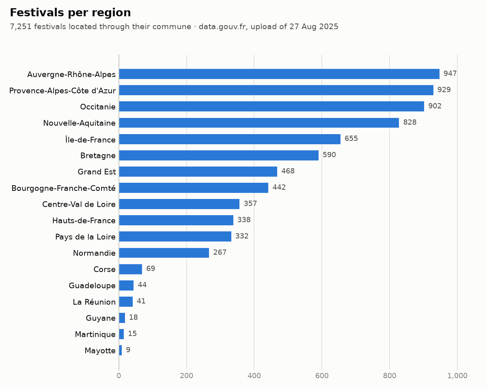
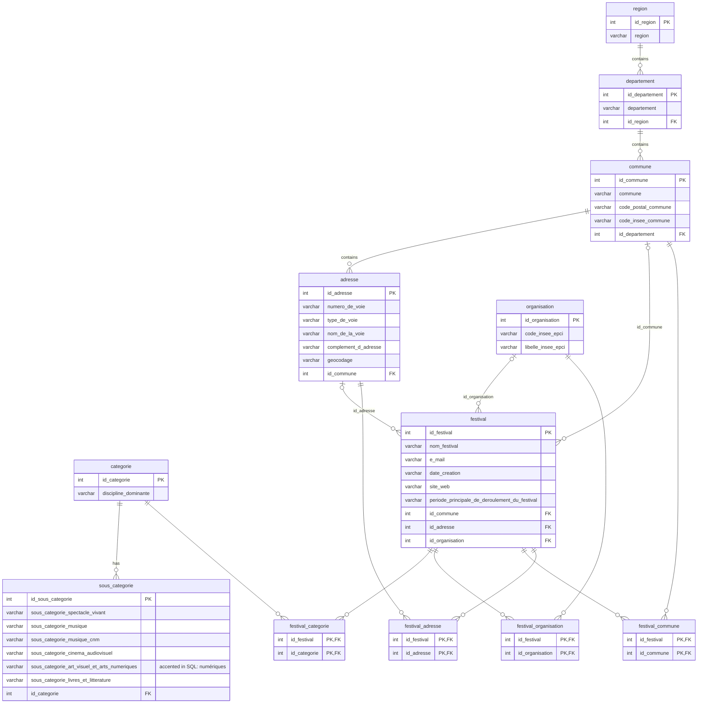

# French Festivals Database: open data to PostgreSQL

**From a raw 7,283-row open-data CSV to a normalised 12-table PostgreSQL database, with a tested pandas ETL and SQL analysis.**

[](https://github.com/Nayl-git/festivals-database/actions/workflows/ci.yml)    

The French Ministry of Culture publishes a national list of 7,283 festivals as a single flat CSV file. This project designs a relational model for it (entity-relationship model, then relational schema normalised up to BCNF), splits the file into 12 tables with pandas, loads them into PostgreSQL and answers a few questions in SQL.



## Context

- **Course project:** SAE 2.01 "Design and implementation of a database", BUT Science des Données (bachelor's degree in data science), IUT de Villetaneuse. Report submitted on 13 May 2024.
- **Team of two:** Nayl Saifoudine and a teammate.
- **Who did what** (from the report's own breakdown):
  - together: the entity-relationship model and the analysis queries;
  - Nayl Saifoudine: the relational model, the start of the table-creation script, the descriptions of both models, the interpretation of the results and the report itself;
  - the teammate: the pandas script that generates the load files, the end of the table-creation script and the population script;
  - each also helped on the other's parts.
- **2024 status:** the 8 entity tables were loaded, the 4 association tables were not (duplicate keys), and the charts were made in Metabase.
- **Revisited in 2026:** the ETL was rewritten so that every table loads, and tests and CI were added (see [What changed after the course](#what-changed-after-the-course)). The schema and the three queries are the 2024 ones, unchanged.

## Data model

Eight entities (`region`, `departement`, `commune`, `adresse`, `categorie`, `sous_categorie`, `organisation`, `festival`) and four association tables linking each festival to its discipline, organisation (EPCI, the inter-municipal body), commune and address. Table and column names are in French, as in the course.



### Normalisation (as argued in the 2024 report)

- **1NF:** every attribute is single-valued.
- **2NF:** the only composite keys belong to the association tables, which have no non-key attribute, so no attribute depends on part of a key.
- **3NF:** two source columns were dropped because they depend on another non-key attribute:
  - the **decade of creation**, which follows from the year of creation (`date_creation`); query 5 shows how to derive it when needed;
  - the **full postal address**, which is the concatenation of street number, street type and street name.
- **BCNF:** no non-key attribute determines part of a key, so the 3NF schema is also in BCNF.

### Looking back (2026)

- Some sub-category cells hold comma-separated lists (for example `Court métrage, Documentaire, Fiction long métrage`), so 1NF holds for the columns as stored but not for their meaning. A `festival_sous_categorie` table with one row per value would fix that.
- In this dataset each festival has exactly one main commune, address, EPCI and discipline, so the association tables repeat the `id_commune`, `id_adresse` and `id_organisation` columns of `festival`. Either side would be enough; the schema keeps both, as designed in 2024, and the tests check that they agree.
- `sous_categorie` is attached to a discipline but not to festivals, so it lists the sub-category combinations that exist rather than which festival has which.

## Pipeline

```
data/festivals-global-festivals-pl.csv.gz      raw CSV without e-mail addresses, 7,283 rows x 29 columns
        |
        |  etl/build_tables.py   (pandas: clean, deduplicate, number, link)
        v
build/tables/*.csv                              one CSV per table, 12 files
        |
        |  sql/01_schema.sql     CREATE TABLE (2024 script)
        |  sql/02_load.sql       \copy, parents before children, foreign keys checked
        |  sql/03_queries.sql    analysis queries
        v
PostgreSQL 16
```

`etl/build_tables.py` keeps the 2024 approach (pandas, one load file per table) and fixes how keys are built:

| Table | One row per | Rows |
|---|---|---:|
| `region` | region name | 22 |
| `departement` | department name | 110 |
| `commune` | INSEE commune code | 3,114 |
| `adresse` | street address within a commune | 4,224 |
| `categorie` | dominant discipline | 6 |
| `sous_categorie` | distinct combination of the six sub-category fields | 1,735 |
| `organisation` | EPCI code | 1,046 |
| `festival` | row of the source file | 7,283 |
| `festival_categorie` | festival | 7,283 |
| `festival_organisation` | festival with an EPCI | 7,247 |
| `festival_commune` | festival with a commune | 7,264 |
| `festival_adresse` | festival with a street address | 4,345 |

Identifiers are deterministic: entity ids follow the sorted natural key (so they do not change if the file is reordered), festival ids follow the order of the source file.

## How to run

Requirements: Python 3.12 and a PostgreSQL 15+ server with `psql` (for `HEADER MATCH`).

```bash
python -m venv .venv
source .venv/bin/activate            # Windows: .venv\Scripts\activate
pip install -r requirements.txt

python etl/build_tables.py           # writes build/tables/*.csv
python -m pytest                     # 56 checks on the snapshot and the generated tables

createdb festivals
psql -v ON_ERROR_STOP=1 -d festivals -f sql/01_schema.sql -f sql/02_load.sql   # run from the repo root
psql -d festivals -f sql/03_queries.sql
```

No local PostgreSQL? `docker run --rm -e POSTGRES_PASSWORD=postgres -p 5432:5432 postgres:16`, then add `-h localhost -U postgres` to the `createdb` and `psql` commands.

Optional: `python scripts/plot_regions.py` redraws the chart above, and `python scripts/download_data.py` downloads the raw file again, checks it against the pinned SHA-256 and rewrites the snapshot without e-mail addresses.

The CI workflow does all of this on every push: ETL, tests, schema, load of the 12 tables into a PostgreSQL 16 service, row-count checks and the queries, failing on any SQL error.

## Results

Measured on the data.gouv.fr file uploaded on 27 August 2025 (see [Data](#data)).

### Query 1: festivals per region (2024 query)

Festivals are placed through `festival -> commune -> departement -> region`: 7,251 of the 7,283 festivals can be placed this way (19 have no commune in the source, 13 are in overseas communes without a department: French Polynesia, New Caledonia, Saint-Pierre-et-Miquelon). Top 5 of 18 regions, all of them in the chart above:

| Region | Festivals |
|---|---:|
| Auvergne-Rhône-Alpes | 947 |
| Provence-Alpes-Côte d'Azur | 929 |
| Occitanie | 902 |
| Nouvelle-Aquitaine | 828 |
| Île-de-France | 655 |

### Query 2: organisations (EPCI) with the most festivals (2024 query)

| EPCI | Festivals |
|---|---:|
| Métropole du Grand Paris | 303 |
| Métropole d'Aix-Marseille-Provence | 270 |
| Métropole de Lyon | 129 |
| Toulouse Métropole | 106 |
| Métropole Européenne de Lille | 90 |

### Query 3: sub-categories per dominant discipline (2024 query)

Number of distinct sub-category combinations recorded for each discipline (5,210 festivals have at least one sub-category).

| Dominant discipline | Sub-category entries |
|---|---:|
| Musique | 930 |
| Livre, littérature | 191 |
| Spectacle vivant | 174 |
| Cinéma, audiovisuel | 164 |
| Pluridisciplinaire | 142 |
| Arts visuels, arts numériques | 134 |

### Query 4: festivals per dominant discipline (added, uses `festival_categorie`)

| Dominant discipline | Festivals | Share |
|---|---:|---:|
| Musique | 3,229 | 44.3 % |
| Spectacle vivant | 1,634 | 22.4 % |
| Livre, littérature | 892 | 12.2 % |
| Cinéma, audiovisuel | 684 | 9.4 % |
| Pluridisciplinaire | 462 | 6.3 % |
| Arts visuels, arts numériques | 382 | 5.2 % |

### Query 5: festivals by decade of creation (added)

5,749 festivals have a four-digit year of creation. 2,697 were created in the 2010s, 1,606 in the 2000s and 825 in the 1990s; years are used as published, including a handful before 1900.

### Comparison with the 2024 report

| | 2024 report | Now |
|---|---|---|
| Query 1 | Provence-Alpes-Côte d'Azur 3,500+, Île-de-France 2,000+, then Centre-Val de Loire, Hauts-de-France, Bourgogne-Franche-Comté (5 regions) | Auvergne-Rhône-Alpes 947, Provence-Alpes-Côte d'Azur 929, Occitanie 902 (18 regions) |
| Query 2 | Métropole d'Aix-Marseille-Provence 1,000+, Métropole du Grand Paris about 370, then CC du Sisteronais-Buëch, Métropole de Lyon, CA de Sophia-Antipolis | Métropole du Grand Paris 303, Métropole d'Aix-Marseille-Provence 270, Métropole de Lyon 129 |
| Query 3 | Musique 6,000+, Pluridisciplinaire and Spectacle vivant far below (3 disciplines) | Musique 930, Livre, littérature 191, Spectacle vivant 174 (6 disciplines) |

The dataset barely changed (see [Data](#data)), so the gap does not come from new data. **The 2024 figures were produced by the load-file bug**, not by the festivals:

- the 2024 script gave every table one row per CSV row and numbered foreign keys from a separate list of distinct values, so `festival.id_commune = 5` meant "the 5th distinct commune" but matched the 5th row of `commune`, which holds the commune of the 5th festival in the file. The joins of queries 1 to 3 therefore matched unrelated rows, and the ranking depended on the order of the file;
- the source never had 3,500 festivals in Provence-Alpes-Côte d'Azur: its region column counts 942 in the archived exports of December 2022 and December 2023 and in the current file;
- running the 2024 script (kept in [`legacy/`](legacy/)) on those two archived exports reproduces the failure: every entity table gets 7,282 rows (22 regions stored as 7,282 rows) and the four association loads stop on duplicate keys. The rankings of query 1 change with the row order of the export and match neither the data nor each other: Centre-Val de Loire first with 1,703 festivals and Corse second with 1,133 on the 2022 export (the file lists 357 and 69), Occitanie first with 1,853 on the 2023 export. The spring 2024 export used for the report is not archived, so its exact figures cannot be recomputed.

## What changed after the course

| 2024 | Now | Why |
|---|---|---|
| One row per CSV row in every table | Entity tables deduplicated on a natural key | `region` had 7,000+ rows for 22 regions |
| Foreign keys numbered separately from the referenced table | One id mapping per table, reused by every foreign key | foreign keys pointed to the wrong rows |
| Association tables keyed on the source `identifiant` | Festivals get their own key, one per source row | `identifiant` is not unique (7,270 distinct values for 7,283 rows, e.g. `FEST__7265`), hence the duplicate-key errors; the 4 association tables now load |
| Missing values written as the text `'null'` | Empty fields, loaded as SQL `NULL` | `'null'` was stored as a real value |
| Raw codes | INSEE and postal codes padded back to 5 digits, `0`, `#N/A` and `#REF!` treated as missing, `01/01/YYYY 00:00` years written as `YYYY` | 563 rows had a 4-digit INSEE code (leading zero lost), and the file contains spreadsheet errors |
| Hard-coded local paths | Relative paths, `\copy ... HEADER MATCH` | runs anywhere, and fails if a file does not match its table |
| No tests | 56 pytest checks and a CI run on PostgreSQL 16 | row counts, unique keys, foreign keys, no lost festival, determinism |

The schema (`sql/01_schema.sql`) and queries 1 to 3 are unchanged; queries 4 and 5 are marked as added.

## Repository layout

```
├── data/festivals-global-festivals-pl.csv.gz   raw data snapshot (Licence Ouverte 2.0)
├── etl/build_tables.py                         raw CSV -> one CSV per table
├── sql/01_schema.sql                           CREATE TABLE (2024)
├── sql/02_load.sql                             \copy commands
├── sql/03_queries.sql                          analysis queries (3 from 2024, 2 added)
├── tests/test_etl.py                           pytest checks on the generated tables
├── scripts/download_data.py                    re-download, verify and remove e-mail addresses
├── scripts/plot_regions.py                     chart of query 1
├── legacy/                                     2024 pandas and \copy scripts, for reference
└── .github/workflows/ci.yml                    ETL + tests + PostgreSQL 16 load + queries
```

## Data

- **Dataset:** [Liste des festivals en France](https://www.data.gouv.fr/datasets/liste-des-festivals-en-france), published by the Ministère de la Culture on data.gouv.fr. Source given by the publisher: *Cartographie nationale, Ministère de la Culture, Deps-doc / France festivals / Cepel, 2022*. It lists festivals held in 2019 (at least two editions, more than one day, at least five shows).
- **File used:** [`festivals-global-festivals-pl.csv`](https://static.data.gouv.fr/resources/liste-des-festivals-en-france/20250827-132958/festivals-global-festivals-pl.csv), uploaded on 27 August 2025, 7,283 rows x 30 columns, `;`-separated, SHA-256 `d7289702cd5fc5f6ecb53d6b11dea499c06b2c61a836cc59f5a2fc1fb1734c27`. It is stored gzipped in `data/` so the project runs offline and gives the same results.
- **Licence:** [Licence Ouverte / Open Licence 2.0](https://www.etalab.gouv.fr/wp-content/uploads/2017/04/ETALAB-Licence-Ouverte-v2.0.pdf) (Etalab), which allows reuse and redistribution with attribution.
- **Privacy:** the snapshot leaves out the contact e-mail column, which the project does not use and which includes personal addresses, and 20 e-mail addresses typed in other columns (mostly the website one). Everything else is unchanged; `festival.e_mail` stays in the schema but is empty.
- **Changes since 2024:** the report used the CSV export of the Ministry's former open-data portal (`data.culture.gouv.fr`, snake_case headers, 7,283 rows according to the report); that portal has since been retired. The current file has the same 30 columns with readable headers and 7,283 rows. Compared with the archived exports of December 2022 and December 2023 (7,282 rows each, [Wayback Machine](https://web.archive.org/web/20231208161343/https://data.culture.gouv.fr/api/explore/v2.1/catalog/datasets/festivals-global-festivals-_-pl/exports/csv?delimiter=%3B&lang=fr&timezone=UTC&use_labels=true)), one festival was added (in Grand Est), and most other differences are formatting (geocoding, codes stored as numbers).

## Credits

- Nayl Saifoudine ([@Nayl-git](https://github.com/Nayl-git)) and a teammate: 2024 model, schema, scripts and analysis (SAE 2.01, BUT Science des Données, IUT de Villetaneuse).
- Data: Ministère de la Culture, Licence Ouverte 2.0.
